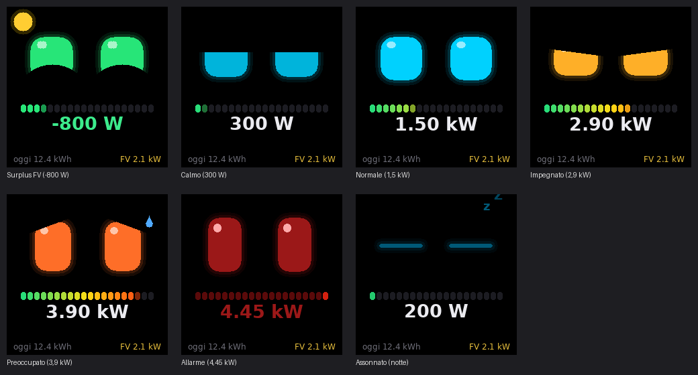

# NM-TV Energy Bot

Un desktop pet per il cubetto **NMMiner NM-TV-154** riflashato con **ESPHome**: due occhi robot animati il cui umore segue i **consumi elettrici di casa** letti da Home Assistant, con barra a segmenti, potenza istantanea, energia di oggi e produzione fotovoltaica.



> Anteprima generata dal codice del display su PC; i font reali sul dispositivo sono Roboto.

## Stati

L'umore dipende dalla potenza prelevata dalla rete, in percentuale della potenza contrattuale (`max_power_w`):

| Stato | Quando | Occhi |
|---|---|---|
| Surplus FV | stai immettendo in rete (sotto −100 W) | verdi e sorridenti, con un sole |
| Calmo | meno del 15% | palpebre rilassate |
| Normale | dal 15 al 50% | ciano, attenti |
| Impegnato | dal 50 all'80% | arancio, concentrati |
| Preoccupato | dall'80 al 97% | angoli che cadono, tremolio, sudore |
| Allarme | oltre il 97%, rischio che salti il contatore | rossi, lampeggiano e tremano |
| Assonnato | consumo basso tra le 23 e le 6 | chiusi, "zZ" |

Tra uno stato e l'altro c'è un'isteresi del 4%, così non saltella quando la potenza sta vicino a una soglia. La potenza è filtrata prima di decidere l'umore.

## Reazioni

- **Sorpresa**: se la potenza sale di colpo di almeno 800 W (forno, bollitore), il pet sobbalza e guarda la barra
- **Sollievo**: se scende di altrettanto
- Con i consumi alti ogni tanto lancia un'occhiata alla barra
- Occhiolino, sbadiglio e sospettoso partono da soli negli stati tranquilli
- Toccando il tetto ti fa l'occhiolino

## Schermo

- Occhi con bagliore, riflesso, transizioni elastiche e squash & stretch
- Barra a 20 segmenti, dal verde al rosso (tutta verde quando immetti)
- Potenza istantanea in grande (W sotto 1 kW, poi kW)
- Riga in basso: energia di oggi e produzione FV (facoltative: se le entità non esistono, non compaiono)

## Integrazione con Home Assistant

- **Selettore "Umore"**: forza uno stato per vederli tutti (`Auto` per tornare ai consumi)
- **Azione `esphome.nmtv_energy_reazione`** con `tipo: sorpresa | sbadiglio | occhiolino | sospettoso | sollievo`
- **Binary sensor "Coccola"** e **luce "Retroilluminazione"**

## Configurazione

In `substitutions`:

| Chiave | Significato |
|---|---|
| `power_entity` | potenza di rete in W: positiva in prelievo, negativa in immissione |
| `solar_entity` | produzione FV in W (facoltativa) |
| `energy_today_entity` | energia consumata oggi in kWh (facoltativa) |
| `power_multiplier` | `1000` se il sensore è in kW, `-1` se il segno è invertito |
| `max_power_w` | potenza contrattuale in W |
| `touch_pin` | pin del tasto sul tetto (da verificare) |

L'ora per lo stato notturno arriva da Home Assistant (`time: homeassistant`).

## Hardware

**NMMiner NM-TV-154** (PCB "NM-TV-Miner"): ESP32-D0WD-V3 (WROOM-32E, 4 MB flash, senza PSRAM), LCD IPS 1,54" 240×240 ST7789 su SPI.

| Funzione | GPIO |
|---|---|
| SPI SCLK / MOSI | 14 / 13 |
| LCD CS / DC / RST | 15 / 2 / — |
| Retroilluminazione (PWM, attiva LOW) | 19 |
| Alimentazione pannello (attiva LOW) | 21 |
| Tasto touch sul tetto | **da verificare** (default 4) |

Il pannello richiede **SPI mode 3**: con mode 0 resta nero.

## Installazione

1. **Backup del firmware originale** (consigliato):
   ```
   esptool --chip esp32 read_flash 0x0 0x400000 nmtv-stock.bin
   ```
2. Copia `nmtv-energy.yaml` in ESPHome e adatta le `substitutions`.
3. Crea `secrets.yaml` partendo da [`secrets.yaml.example`](secrets.yaml.example). La chiave API va generata con `openssl rand -base64 32`. Non è il token di accesso di Home Assistant.
4. Primo flash via USB, poi aggiornamenti OTA.
5. In HA **aggiungi il dispositivo all'integrazione ESPHome** con la stessa chiave: senza questo passaggio i dati non arrivano.

## Progetto gemello

[nmtv-weather-pet](../../../nmtv-weather-pet): lo stesso cubo, con l'umore guidato da meteo e temperatura esterna.

## Crediti

- Pin map dalla [guida ufficiale NMMiner per il firmware custom su NM-TV-154](https://www.nmminer.com/2026/03/02/how-to-develop-nm-tv-custom-firmware/)
- Note sull'hardware verificate in [smalltv-mod](https://github.com/giovi321/smalltv-mod)

Progetto non affiliato a NMMiner/NMTech. Il firmware ESPHome sostituisce completamente quello originale (il dispositivo smette di minare).

## Licenza

[MIT](LICENSE)
